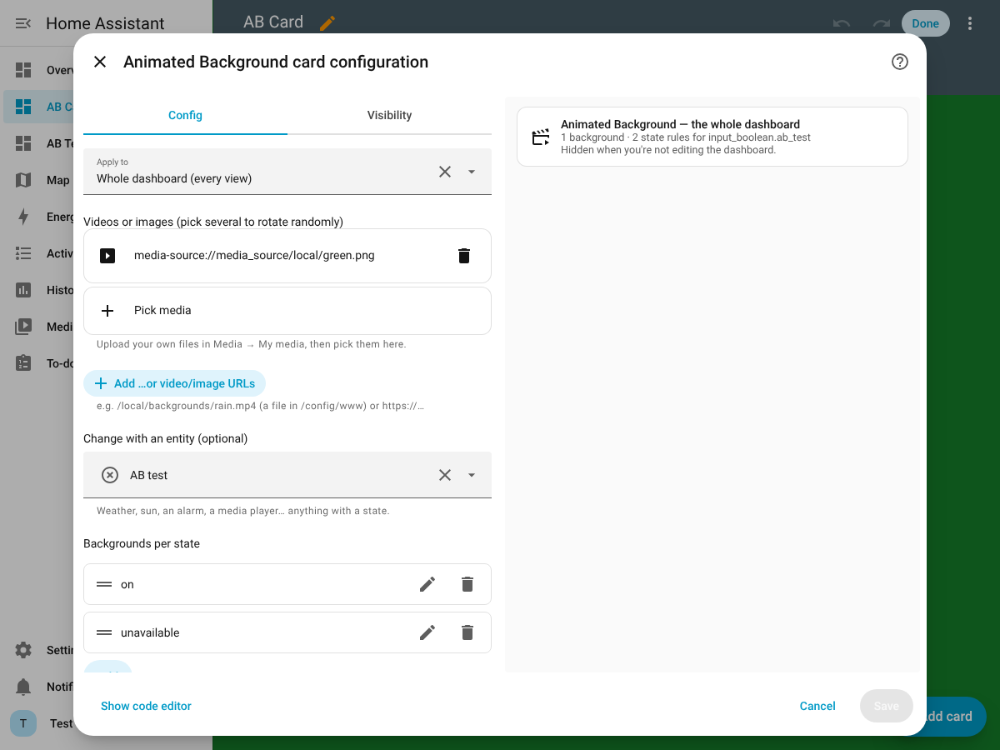

# Animated Background for Home Assistant

[](https://hacs.xyz/docs/faq/custom_repositories)
[](https://github.com/MrVess/ha-animated-background/actions/workflows/validate.yml)

**Make your dashboard feel alive.** Animated Background plays your own looping video or image
behind any Home Assistant dashboard, and it can follow your home. Show rain when it's raining,
a starry sky after sunset, a red alert when the alarm is armed, or album art when the music
is playing.

Set it up entirely in the UI. Add the **Animated Background** card, upload your own clips in
**Media → My media**, and pick them from the card editor. No YAML or file shares needed, though
YAML still works if you prefer it.



### Features
- 🎬 Video (`.mp4` `.webm` `.mov`, muted and looping, autoplays on phones and tablets) or images (`.jpg` `.png` `.gif` `.webp`)
- 📁 Use **your own media**: upload it in HA's Media browser, put it in `/config/www`, or paste any URL
- 🌦️ **Change with any entity's state**: weather, sun, alarm, media player, a helper…
- 🎲 Pick several clips to **rotate randomly**
- 🗂️ One background for the **whole dashboard**, or a **different one per view**
- 🎨 Optional **tint** so your cards stay readable
- 👤 Turn it on or off **per user or per device** (YAML)
- Tested on Home Assistant **2026.11**. Works on 2024.1 and later.

## Install

### HACS (recommended)
[](https://my.home-assistant.io/redirect/hacs_repository/?owner=MrVess&repository=ha-animated-background&category=plugin)

Or by hand: **HACS → ⋮ → Custom repositories**, add `https://github.com/MrVess/ha-animated-background`
with type **Dashboard**, then find **Animated Background**, click **Download**, and reload your browser.

<details><summary>Manual install (no HACS)</summary>

1. Copy `dist/animated-background.js` to `/config/www/`.
2. **Settings → Dashboards → ⋮ → Resources → Add resource**: URL `/local/animated-background.js`,
   type *JavaScript module*. Then reload your browser.
</details>

## Set it up in the UI
1. *(Optional)* Upload your videos or images: **Media → My media → Upload** (the ⤒ button).
2. Open a dashboard you created, click ✏️ **Edit**, then **Add card**, and search for **Animated Background**.
3. In the card editor:
   - **Apply to**: the *whole dashboard*, or *only the view this card is on*.
   - **Videos or images**: click **Pick media** and choose your uploads. Pick several to rotate randomly.
     You can also use a **URL** instead.
   - **Change with an entity** *(optional)*: choose an entity, then add **Backgrounds per state**
     (for example `rainy` → rain clip). A state with no media uses your normal theme background.
   - **Tint** *(optional)*: a colour and strength to darken or colour the background.
4. **Save**, then click **Done**.

The card is **invisible** on the dashboard and only shows up while you're editing. A card set to
*only this view* takes priority over a *whole dashboard* card.

## …or set it up in YAML
Add an `animated_background:` block at the **top level** of a dashboard's raw configuration
(✏️ → ⋮ → **Raw configuration editor**), next to `views:`:

```yaml
animated_background:
  entity: weather.home
  default_url: /local/backgrounds/clouds.mp4        # used when no state matches
  state_url:
    sunny: /local/backgrounds/sunny.mp4
    rainy: [/local/backgrounds/rain1.mp4, /local/backgrounds/rain2.webm]   # random pick
    clear-night: none                                # 'none' = normal theme background
  background: "rgba(0,0,0,0.25)"                    # optional tint
views:
  ...
```

| Key | Description |
|---|---|
| `default_url` | URL, or list of URLs (one is picked at random). `media-source://…` ids work too |
| `entity` | Entity whose state selects the background |
| `state_url` | Map of `state: url`. Values can be a URL, a list, or `none` |
| `background` | CSS colour/gradient drawn **over** the media as a tint, e.g. `rgba(0,0,0,0.3)` |
| `enabled` | `false` to switch off (handy inside a view or group) |
| `included_users` / `excluded_users` | HA user display names |
| `included_devices` / `excluded_devices` | Text matched against the browser user agent (`iPhone`, `Android`, `Windows`, `Macintosh`…) |
| `views` | List of `{ path, config }`. Overrides for a view by its path |
| `groups` | List of `{ name, config }`. Reusable configs. Pick one per view with `animated_background: <name>` in that view, or `none` to disable |
| `debug` | `true` logs decisions to the browser console |

More in [`examples/`](examples/). If both are used, the order of priority is: a card for
*this view* → YAML `views`/`groups` → a *whole dashboard* card → YAML top level.

## Tips
- **See-through cards:** cards are solid by default. Use a theme like
  [`examples/theme-transparent-cards.yaml`](examples/theme-transparent-cards.yaml)
  (`ha-card-background: rgba(20, 20, 20, 0.35)`).
- **Keep clips light:** 720p/1080p and a few MB loop smoothly, even on wall tablets.
- The built-in auto-generated **Overview/Home** dashboard can't be edited. Use a dashboard you
  created (**Settings → Dashboards → Add dashboard**).
- Some browsers won't autoplay video when battery saver is on.

## Inspiration and credit
This project is inspired by [**lovelace-animated-background**](https://github.com/Villhellm/lovelace-animated-background)
by [Villhellm](https://github.com/Villhellm). That project brought cinemagraph-style, state-driven
backgrounds to Home Assistant in 2020 and was loved by the community, but it stopped working as
the HA frontend evolved and was archived.

Animated Background is a from-scratch rewrite for today's Home Assistant. It keeps the original's
idea and **YAML config format**, so existing `animated_background:` blocks should work unchanged.
It adds a visual card editor, Media library support and a tint option. To migrate, remove the old
resource and install this one. Note that `background: transparent` (the old default) now does
nothing, because `background:` is a tint overlay.

Thank you, Villhellm, for the original idea. 💙

## License
[MIT](LICENSE). Free to use, change and share.
